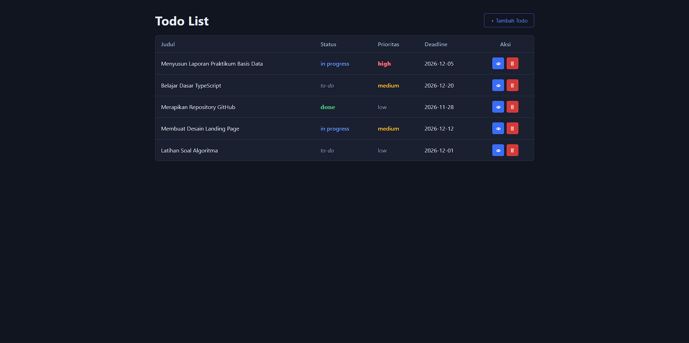
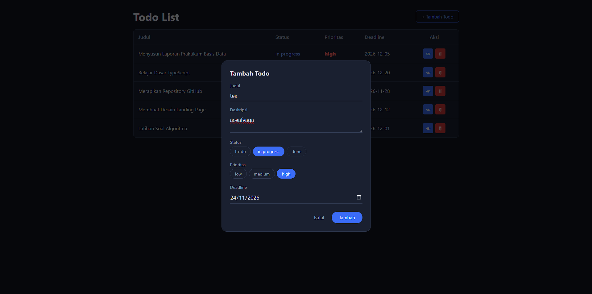
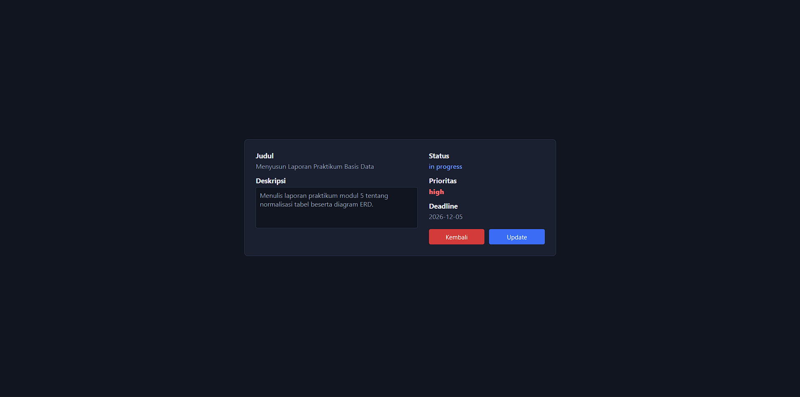
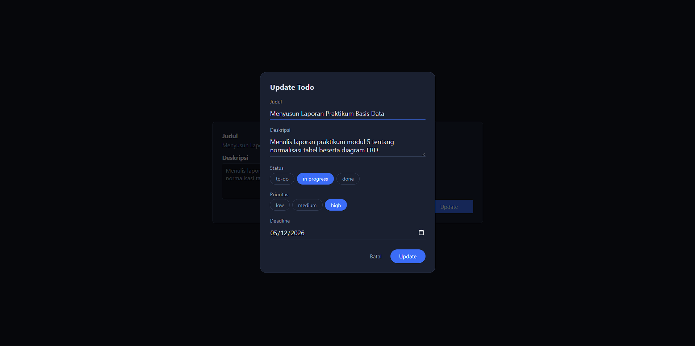

# Todo List – React.js

Aplikasi To-Do List frontend (React + Vite) untuk Kuis Praktikum. Menggunakan data dummy dan React State, tanpa backend/REST API.

## Fitur
- Menampilkan daftar tugas
- Melihat detail tugas (`/todo/:id`)
- Menambah tugas (modal form)
- Memperbarui tugas (modal form di halaman detail)
- Menghapus tugas (dengan konfirmasi)
- Notifikasi singkat setelah tambah / update / hapus

## Struktur data
```js
{ id, title, description, priority, deadline, status }
```
Sesuai atribut REST API (`/api/todos`) sehingga mudah diintegrasikan nanti.

## Menjalankan
```bash
npm install
npm run dev
```
Buka http://localhost:5173

## Screenshot

| Daftar Todo | Tambah Todo |
|---|---|
|  |  |

| Detail Todo | Update Todo |
|---|---|
|  |  |
